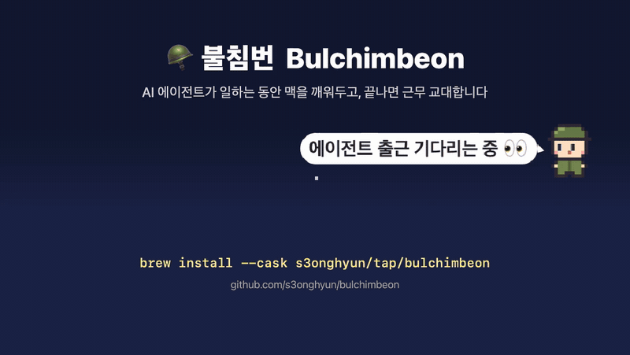

# 🪖 불침번 (Bulchimbeon)

> **Your Mac's night-watch soldier.**
> 내가 자는 동안 AI 에이전트 곁에서 맥을 깨워두고, 일이 끝나면 "근무 교대합니다!" 하고 재워주는 메뉴바 이등병.
>
> **hook도, 데몬도, 설치되는 root 도우미도 없이 앱 하나로. macOS 13부터.**

> 🌐 [English](README.en.md) · [日本語](README.ja.md) · [简体中文](README.zh-CN.md)



| 상태 | 이등병 | 언제 |
|------|--------|------|
| 💤 취침 | 방탄모 쓰고 꾸벅, zzz | 근무 없음 |
| 👀 근무 대기 | 두리번두리번 | 에이전트 출근 감시 중 |
| 🪖 근무 중 | 손전등 깜빡이며 경계 | 맥이 잠들지 않음 |
| 🫡 근무 교대 | `^ ^` 충성! 경례 | 에이전트 작업 끝 / 근무 시간 종료 |
| 🥵 전투휴식 | 땀 뻘뻘, 눈 감고 열 식히기 | 폭염 경보 |

### 🚶 순찰 모드


메뉴바 바로 아래, 화면 맨 위를 이등병이 손전등을 들고 좌우로 순찰한다.
근무 대기 중엔 오른쪽 구석에서 두리번, 교대 땐 그 자리에서 경례하며 말풍선으로 "근무 교대합니다! 🫡". 취침 중엔 퇴근(숨김).
클릭은 모두 통과하고, 마우스가 다가오면 반투명해져 비켜준다. 메뉴에서 끄기·크기(2배/3배) 조절.
전체화면 앱(발표·화면 공유·영상) 위에는 나타나지 않는다.

## 왜 만들었나

AI 에이전트를 돌려놓고 자려면 이렇게 했다.

```bash
caffeinate -d                 # 끄는 걸 잊는다
sudo pmset disablesleep 1     # 되돌리는 걸 잊으면 배터리 0%
```

불침번은 **에이전트가 떠 있는 동안만** 깨어 있고, 끝나면 알아서 근무를 교대한다.

## 기능

| 기능 | 설명 |
|------|------|
| 🤖 에이전트 근무 (자동 교대) | Claude Code · Codex · Gemini CLI · Cursor · Copilot CLI · Aider · OpenCode 감지 (+사용자 지정). **열려만 있는 세션은 세지 않고 실제로 일할 때만 근무**, 조용해지고 5분 뒤 교대 → 있으면 근무 투입, 모두 끝나면 교대 알림 |
| 🪖 근무 서기 | 30분 / 1시간 / 2시간 / 4시간 / 무기한 |
| 근무 형태 | 화면 켜둠 (`caffeinate -d`) · 화면은 꺼져도 맥은 깨어 있음 (`caffeinate -i`) · **덮개 닫아도 깨어 있음** (관리자 권한) |
| 🔋 배터리 철수 | 배터리 사용 중 잔량이 기준(기본 20%) 이하면 강제 철수 |
| ⚠️ 덮개 안전장치 | 근무 종료·앱 종료 시 `disablesleep` 원복, 비정상 종료 후 재실행하면 복구 버튼 |
| 🌡️ 폭염 주의보 → 🔥 전투휴식 | 맥이 뜨거워지면 경고, 아주 뜨거우면 근무를 잠시 멈춰 식히고 **열이 내리면 자동 복귀** (덮개 닫고 가방에 넣는 사고 방지) |
| ⚠️ 근무지 이탈 감지 | 잠자기 방지가 어떤 이유로든 풀려 있으면 즉시 재투입 |
| 🕵️ 당직 감시병 | 덮개 모드 중 앱이 강제 종료돼도 5초 안에 원래 잠자기 설정으로 복구 |
| 📋 당직 근무 인수인계 | 10분 이상 자리를 비웠다 돌아오면 그사이 근무 내역 보고 ("근무 교대 1회 · 폭염 1회 … 이상입니다! 🫡") |
| 🖥️ 다른 앱 표시 | 이 앱 말고 잠자기·화면 꺼짐을 막는 앱도 메뉴에 표시 (예: "Vivaldi (영상)") |
| 🔁 근무 유지 | 앱 재시작·업데이트·재부팅 후에도 남은 근무 시간 그대로 복귀 (덮개 근무는 보안상 시스템 근무로 복귀 후 재승인 안내) |
| 🌐 한국어·영어 | 기본은 시스템 언어. 메뉴 **언어 / Language** 에서 따로 고를 수 있음 (시스템은 영어인데 앱은 한국어로 등) |
| 📒 근무일지 | `~/Library/Application Support/Bulchimbeon/duty-log.txt` |

## 비슷한 앱과 비교

같은 문제를 푸는 앱으로 [Adrafinil](https://github.com/kageroumado/adrafinil)이 먼저 나와 있다. 접근이 반대라서 맞는 쪽을 고르면 된다. (2026-10 기준)

| | 불침번 | Adrafinil |
|---|---|---|
| 일하는 중인지 아는 법 | **밖에서 관찰** — 에이전트 프로세스의 `caffeinate` 자식·CPU 사용량 | **에이전트가 직접 알림** — hook(프롬프트 제출 시 획득, 응답 끝나면 해제) + 관찰 |
| 설치하면 바뀌는 것 | **없음.** 앱 하나, 에이전트 설정 파일을 건드리지 않음 | 에이전트 설정에 hook 추가(원클릭 설치·제거), 사용자 데몬, root 도우미 |
| macOS | **13 이상** | 26.4 이상 |
| 덮개 닫고 깨어 있기 | 켤 때마다 관리자 암호, 감시병이 원상 복구 보장 | 설치 때 한 번 승인, 이후 암호 없음 |
| 에이전트가 직접 근무 요청 (긴 빌드 등) | — | CLI·MCP 도구 |
| 발열 | 덮개 열려 있어도 경고, 너무 뜨거우면 쉬었다가 **식으면 자동 복귀** | 덮개 닫혔을 때 과열 시 강제 해제 |
| 배포 | ad-hoc 서명 (공증 준비 중), 개인 Homebrew tap | 공증, Homebrew 공식 cask |

**이럴 땐 Adrafinil**: macOS 26.4 이상이고, hook으로 정확하게 맞물리거나 에이전트가 직접 근무를 요청하게 하고 싶을 때.
**이럴 땐 불침번**: macOS 13~15를 쓰거나, 에이전트 설정·시스템에 아무것도 설치하고 싶지 않거나, 이등병이 지켜주는 게 좋을 때.

## 설치

```bash
brew install --cask s3onghyun/tap/bulchimbeon

# 업데이트 — tap 을 먼저 새로 받아야 새 버전이 보인다 (Homebrew 자동 갱신 주기가 길다)
brew update && brew upgrade --cask bulchimbeon
```

또는 [Releases](https://github.com/s3onghyun/bulchimbeon/releases) 에서 zip 을 받아 `/Applications` 로 옮긴다. (macOS 13+, Apple Silicon·Intel universal)

> **첫 실행:** 아직 Apple 공증(notarization)을 받지 않은 ad-hoc 서명 앱이라 macOS 가 실행을 막는다.
> 한 번 열기를 시도한 뒤 **시스템 설정 → 개인정보 보호 및 보안 → "그래도 열기"** 를 누르면 된다.
> (macOS 15 부터는 우클릭 → 열기로 우회되지 않는다.)
> 공증 전에는 macOS 가 알림 권한을 주지 않아서, 알림이 **"스크립트 편집기"** 이름으로 표시된다.

### 받은 파일 검증 (선택)

릴리스 zip 은 GitHub Actions 에서 빌드되고 빌드 출처 증명(attestation)이 붙는다.

```bash
gh attestation verify Bulchimbeon-<버전>.zip --repo s3onghyun/bulchimbeon
shasum -a 256 -c Bulchimbeon-<버전>.zip.sha256
```

## 개발

Xcode 없이 Command Line Tools 만 있으면 된다.

```bash
make app        # dist/Bulchimbeon.app 생성 (ad-hoc 서명)
make run        # 빌드 후 실행
make test       # 단위·시나리오 테스트
make icons      # 스프라이트 수정 후 앱 아이콘·미리보기 재생성

# 실행과 동시에 에이전트 근무 시작
open dist/Bulchimbeon.app --args --agent-watch

# 엔진이 내리는 명령을 stderr 로 출력 (추적용)
BULCHIMBEON_DEBUG=1 dist/Bulchimbeon.app/Contents/MacOS/Bulchimbeon
```

### 릴리스

```bash
git tag vX.Y.Z && git push origin vX.Y.Z   # → Release 워크플로가 빌드·증명·업로드
./scripts/bump-cask.sh X.Y.Z               # → 체크섬·출처 증명 검증 후 homebrew-tap 갱신
```

## 동작 원리

| 근무 형태 | 내부 동작 |
|-----------|----------|
| 화면 켜둠 | `IOPMAssertion` `PreventUserIdleDisplaySleep` — `caffeinate -d` 와 같음 |
| 화면은 꺼져도 맥은 깨어 있음 | `IOPMAssertion` `PreventUserIdleSystemSleep` — `caffeinate -i` 와 같음 (기본값, 절전) |
| 덮개 닫아도 깨어 있음 | 위 + `pmset -a disablesleep 1` (덮개 닫힘은 하드웨어 트리거라 assertion 으로 못 막음) |

### 에이전트 감지

현재 사용자의 프로세스를 libproc 으로 훑어 아래 신호 중 하나라도 맞으면 에이전트로 본다.
부분 문자열 매칭은 하지 않는다 (Claude Code hook 의 `node -e "...'.claude'..."` 를 오탐하므로).

| 설치 방식 | 실제 프로세스 모습 | 판별 근거 |
|-----------|-------------------|-----------|
| Claude Code 네이티브 설치 | 실행 파일 `~/.local/share/claude/versions/2.1.296` (이름이 버전 번호!) | `argv[0]`=`claude` 또는 설치 경로 |
| Homebrew·IDE 확장 내장 바이너리 | `.../claude`, `/opt/homebrew/bin/codex` | 실행 파일 이름 |
| npm 전역 설치 | `node /opt/homebrew/bin/claude` | 스크립트 이름 |
| npx·패키지 경로 실행 | `node .../@anthropic-ai/claude-code/cli.js` | 패키지 경로 |
| bun·deno | `bun .../@google/gemini-cli/...` | 패키지 경로 |

지원: Claude Code · Codex · Gemini CLI · Cursor Agent · Copilot CLI · Aider · OpenCode

**일할 때만 근무.** Claude Code 창을 여러 개 열어 두는 게 보통이라, 열려 있기만 한 세션까지 세면 교대가 영원히 일어나지 않는다.
그래서 "작업 중"인 에이전트만 센다 (메뉴에서 예전 방식으로 바꿀 수 있음).

| 신호 | 근거 (실측) |
|------|------------|
| 자식 프로세스로 `caffeinate` 를 띄움 | Claude Code 는 작업하는 동안만 스스로 `caffeinate -i -t 300` 을 띄운다 |
| 자신 + 자손 프로세스 CPU 합 ≥ 2% | 빌드·테스트 같은 도구 실행 포함. 입력 대기 세션은 0~0.1% |
| `--tools=` (도구 없는 헤드리스 세션) 은 제외 | claude-mem 같은 플러그인이 상시 띄워 두는 도우미 세션 |

내 환경에서 제대로 잡히는지 확인하거나, 목록에 없는 에이전트를 추가하려면:

```bash
/Applications/Bulchimbeon.app/Contents/MacOS/Bulchimbeon --diagnose
defaults write io.github.s3onghyun.bulchimbeon customAgents -array goose amp
```

Docker 컨테이너나 SSH 원격 서버에서 도는 에이전트는 이 맥의 프로세스가 아니라서 잡히지 않는다.

```bash
pmset -g assertions | grep Bulchimbeon   # 근무 중인지 확인
```

스프라이트는 `Sources/BulchimbeonCore/Sprites.swift` 의 ASCII 그리드다. 문자 하나가 픽셀 하나이고,
메뉴바(1pt=1px)와 1024px 앱 아이콘을 같은 원본에서 벡터 사각형으로 그려 어느 크기에서도 선명하다.

근무 판단은 시스템 호출이 없는 상태 머신(`DutyEngine`)에 있고, 가짜 시계로 시나리오 테스트한다.
설계 상세 (검토했지만 넣지 않은 신호 포함): [docs/design.md](docs/design.md)

## 로드맵

[마일스톤](https://github.com/s3onghyun/bulchimbeon/milestones)으로 관리한다. 1.0 = 동작·설정 키·실행 인자가 더 이상 바뀌지 않는다는 약속.

- [x] 치비 이등병 픽셀아트, 순찰 모드, 한국어·영어
- [x] 에이전트 **작업 중 / 대기 구분** (열려만 있는 세션은 세지 않음)
- [x] Homebrew cask (개인 tap)
- [ ] Apple 공증 + Homebrew 공식 cask (Developer ID 필요)
- [ ] Privileged helper 로 덮개 모드 암호 프롬프트 제거
- [ ] 해금 스킨: 순라꾼(조선시대 불침번), 선비(현량자고)

## 보안

관리자 권한 `pmset` 실행과 프로세스 명령줄 읽기를 다루는 앱이라 위협 모델을 따로 정리했다 → [SECURITY.md](SECURITY.md)

- 네트워크 통신 없음, 서드파티 의존성 0개
- 셸 인젝션 불가 구조, 절대 경로 실행, 최소 환경변수
- 프로세스 인자 원문은 저장·기록하지 않음, AI 대화 기록은 읽지 않음
- hardened runtime 서명, 릴리스 SHA-256 체크섬·빌드 출처 증명, SHA 고정 CI

## 기여

버그 신고(🚨 근무 태도 불량 신고), 에이전트 추가 요청, 대사·스프라이트 아이디어 모두 환영합니다 → [CONTRIBUTING.md](CONTRIBUTING.md)

## 주의

덮개를 닫은 채 무거운 작업을 오래 돌리면 발열이 생긴다. 가능하면 전원을 연결하고 쓰자.

## License

MIT
